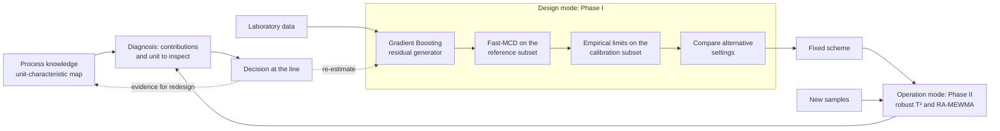

# GB-RAMEWMA Studio

Design a multivariate quality-monitoring scheme on your own laboratory data, run it, and trace each alarm to the unit of the line that should be inspected first.

The application implements GB-RAMEWMA: Gradient Boosting forecast residuals monitored with a robust Hotelling-type T² chart and a robust adaptive-λ MEWMA (RA-MEWMA) chart, with Fast-MCD estimates from a reference subset and empirical limits from a separate calibration subset. It accompanies the manuscript *Interactive monitoring-scheme design and fault diagnosis for compound NPK granulation: a robust adaptive MEWMA tool based on Gradient Boosting residuals* (M. Ahsan, M. A. Abbad, L. O. Syahriman, T. A. Nandiani, V. L. Ardi; submitted). Equation and section numbers in the code refer to that manuscript.

## What it does

The interface has five views that follow the procedure.

1. **Data**: upload a CSV or Excel file, choose the time column and the quality characteristics, check gaps and descriptive statistics.
2. **Design the scheme** (Phase I): set the training share, the lag window and the Gradient Boosting settings, the reference share, the calibration quantile *q*, the bounds λmin and λmax and the start-up rule; fit the scheme and compare the alarm load of alternative reference shares and quantiles before fixing it.
3. **Monitor** (Phase II): robust T² and RA-MEWMA charts with their limits, signals coloured by the characteristic with the largest contribution, start-up windows shaded; score new laboratory results with the fixed scheme.
4. **Diagnose alarms**: contributions of each characteristic (Eq. 14) combined with editable process-knowledge rules that name the unit to inspect first.
5. **Export**: signals, charting statistics and a JSON scheme file with the data period, all settings, the Fast-MCD estimates, the limits and the software versions.



## Installation

Python 3.12 was used for development.

```bash
git clone https://github.com/ahsan4th/gb-ramewma-studio.git
cd gb-ramewma-studio
python -m venv .venv
source .venv/bin/activate        # Windows: .venv\Scripts\activate
pip install -r requirements.txt
streamlit run app.py
```

The browser opens at `http://localhost:8501`. To look around first, choose **Synthetic demo data** in the sidebar.

## Your own data

One row per laboratory sample, a time column and at least two numeric quality characteristics, in CSV or Excel. Rows with a missing characteristic are removed, not imputed. Times written as `dd/mm/yy` need the *day first* option in the sidebar; ISO times (`YYYY-MM-DD HH:MM`) are read directly. The default diagnosis rules are written for an NPK granulation line (columns named `H2O`, `N`, `P2O5`, `K2O`); for another line, edit the two rule tables in the **Diagnose alarms** view.

## Case-study settings

| Setting | Value |
|---|---|
| Training share | 0.80 (1,187 of 1,484 samples) |
| Lag window *w* | 24 samples |
| Gradient Boosting | 200 trees, learning rate 0.04, depth 2, seed 42 |
| Reference share | 0.70 (Fast-MCD, `MinCovDet(random_state=42)`) |
| Calibration quantile *q* | 0.95, type-1 sample quantile |
| RA-MEWMA bounds | λmin = 0.05, λmax = 0.35 |
| Start-up samples | first 6 samples after a gap longer than 24 h |

The values live in `gbramewma/config.py`; every one can be changed in the interface.

## Demo data

The plant data of the case study are confidential and are not part of this repository. `gbramewma/demo.py` generates an artificial four-hourly series with the same columns, similar summary statistics, serial dependence, level changes, heavy-tailed noise, stoppage gaps and two injected faults. The application uses it directly; `python data/make_demo_data.py` writes it to a CSV file. These values are not plant measurements and cannot reproduce the reported results.

## Reproducing the case-study values

With the plant data (available from the corresponding author with the permission of the company):

```bash
python scripts/verify_case_study.py path/to/plant_data.xlsx
```

The script recomputes the values reported in Section 6.4 of the manuscript (limits, signal counts, start-up counts, Table 12 grid) and exits with status 1 if any value differs. As a failure control, `--quantile 0.975` changes the calibration quantile and must report mismatches.

Implementation details that matter for exact reproduction: lagged inputs are ordered lag 1 first (`[y_{t-1}, ..., y_{t-w}]`, all characteristics of one lag together); features and targets are standardized on the training windows. Tree ensembles break ties between equally good splits by the order of the input columns, so equivalent orderings or scalings move the test MAPE between 9.072% and 9.084% and the RA-MEWMA test count between 27 and 30, while the limits, the training counts and the robust T² test count stay the same.

## Tests

```bash
pip install pytest
pytest -q
```

The unit tests cover the type-1 quantile, the lag layout, the robust T², the RA-MEWMA recursion and weights, the contributions, the start-up windows and the use of the calibration subset for the limits, including deliberately wrong inputs that must be rejected.

## Citation

Please cite the accompanying article once it is published. Until then:

```bibtex
@unpublished{ahsan_gbramewma_studio,
  author = {Ahsan, Muhammad and Abbad, Muhammad Akmal and Syahriman, La Ode and Nandiani, Tiara Aulia and Ardi, Vivi Lathifah},
  title  = {Interactive monitoring-scheme design and fault diagnosis for compound {NPK} granulation: a robust adaptive {MEWMA} tool based on Gradient Boosting residuals},
  note   = {Manuscript submitted for publication. Code: https://github.com/ahsan4th/gb-ramewma-studio},
  year   = {2026}
}
```

## License

MIT License, see `LICENSE`.
